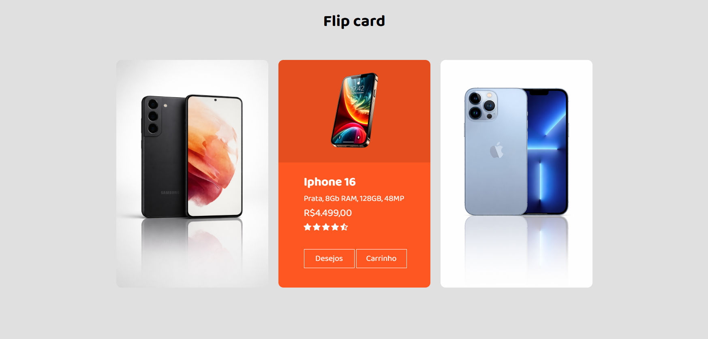

# 📱 Flip Card Smartphone

Projeto de cards interativos de smartphones, desenvolvido com **HTML5 e CSS3** como parte de uma atividade prática do curso PROA.

O projeto tem como objetivo explorar conceitos de animações tridimensionais, transformações CSS e interatividade visual, utilizando o efeito de rotação para apresentar informações dos produtos.

## 🖥️ Prévia do projeto

🔗 **[Acesse o projeto online](https://gabrielc0liveira.github.io/Projeto2Proa-FlipCardSmartphone/)**

## Funcionalidades e características

- Exibição de três cards interativos de smartphones.
- Animação de rotação 3D ao passar o mouse sobre os cards.
- Apresentação de informações dos produtos, como especificações, preços e avaliações.
- Botões ilustrativos de lista de desejos e carrinho com efeitos hover.
- Personalização visual dos cards com diferentes cores e imagens.
- Organização dos elementos utilizando Flexbox.

## Tecnologias utilizadas

- **HTML5:** estruturação e organização dos cards e informações dos produtos.
- **CSS3:** estilização, posicionamento, transformações 3D e animações interativas.
- **Font Awesome:** utilização de ícones para representar as avaliações dos produtos.
- **Google Fonts:** utilização da fonte Baloo 2.

## Aprendizados

Durante o desenvolvimento, foram praticados conceitos como:

- Estruturação e organização de elementos utilizando HTML.
- Organização de layouts com Flexbox.
- Criação de efeitos tridimensionais utilizando `perspective` e `rotateY()`.
- Utilização das propriedades `backface-visibility` e `transform-style`.
- Desenvolvimento de animações e transições com `transition` e `hover`.

## 📂 Como executar o projeto

🔗 **[Acesse o projeto online](https://gabrielc0liveira.github.io/Projeto2Proa-FlipCardSmartphone/)**

---

Desenvolvido por **Gabriel Oliveira** como parte das atividades práticas do PROA.
